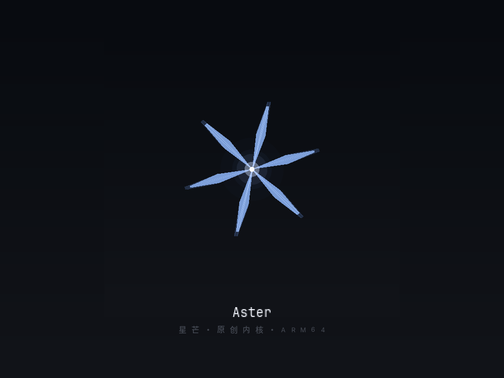
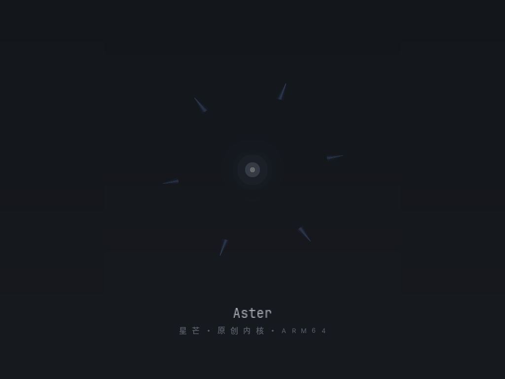

# Aster · 星芒

从零写起的 ARM64 系统：**原创引导器 + 原创内核 + 原创三级镜像校验**，不基于任何现有内核（没有 Linux、没有 Zircon、没有 *BSD 的任何代码）。

当前是 **v0.9**（内核里 `update.rs` 的 `CURRENT_VER`）：阶段二收口（用户态 + 抢占调度 + 图形 + 键盘 + 网络 + W^X + 每任务页表）之后，界面、存储、APK、更新与权限都已经长在这套内核里——

- 内核把程序装进只属于它的 4 KiB 代码页和栈页，切到 EL0 执行，程序只能通过 `svc` 请求内核做事；每 2 ms 定时器中断打断一次，调度器在任务之间轮转。
- ramfb 图形通路把内存帧缓冲交给 QEMU 的显示器，画的是**桌面**：顶栏、左侧图标、带标题栏的终端窗口、底部任务栏（开始按钮 / 运行中程序 / 键盘与网络状态灯 / 运行时长）。
- **键盘能用了**：virtio-input 驱动把 Linux 键码翻成 ASCII，字符环喂给 shell——在 VNC 画面里直接敲命令，不必再开串口。
- **网络是真的在内核里**：virtio-net 驱动 + 自研 ARP/ICMP/TCP + HTTP 服务，宿主的 `curl` 打进来能拿到 Aster 自己生成的页面。
- **内核崩了也留证据**：panic 与 EL1 致命异常统一进 `crash.rs`，串口先打全现场，有屏幕时再画一张 `KERNEL PANIC`（SP/LR/ESR/FAR/SPSR/TTBR0 + 文件:行:原因），然后停机——不静默死循环。

- **界面抗锯齿**：字模从二值改成 4-bit 灰度，绘制时按覆盖率混合；窗口与图标是圆角（角落算到圆心的距离），带三层柔和投影和玻璃质感的高光边。663 个汉字的点阵加起来 90 KiB，全部在 `.rodata` 里，不依赖任何 GPU。

鼠标与窗口管理、磁盘与文件系统、APK/EXE 兼容层仍是后续阶段，见 [docs/roadmap.md](docs/roadmap.md)（已写成到 v1.0 的完整阶段表，含阶段 2.5 与存储的 A/B 两个里程碑）。

---

## APK 容器

`apk` 列目录、取 `classes.dex` 头、校验二进制 XML；`apk2` 走 DEFLATE 解压（stored / 固定 Huffman / 动态 Huffman 三条路径 + LZ77 回拷），`assets/demo2.apk` 里 6036 字节的 dex 压到 153 字节，解回来长度与 FNV-1a 指纹都对得上。

## 跑一个 APK

`dex` 打印 DEX 结构（字符串、类型、方法、类，带 adler32 校验）；`dex run` 真正执行 `Lcom/aster/Main;->run()`：const-string 取字符串、invoke-static 桥接到内核打印、return-void 收尾。

样例 DEX 里有一个真程序：循环 `i = 1..5` 累加，用 `if-gt` 跳出、`add-int` 累加、`goto` 回跳，最后打印 `15`。样例 DEX 不是 dx/d8 产物，是 `tools/mkdex.py` 按规范手拼的 536 字节文件（header / map_list / ids / class_defs / data 全手写，checksum 与 sha1 最后回填）。

## 开机动画

冷启动后先播 2.4s 的星芒动画：六个尖依次从黑场里长出来（尖端跟一个光点），缓转，字标淡入上浮，最后六瓣各自散开、画面融到桌面色 —— 全程无外部素材，用内核自带的光栅原语逐像素画。



| 生长 | 散场 |
|---|---|
|  |  |

无头环境下用 `bootframe <ms>` 定格任意时刻取证（`-display none` 下运行中抓屏必撕裂，不能用）。
已经验证能跑的部分

| 能力 | 状态 | 验证方式 |
| --- | --- | --- |
| 引导器上电接管（EL1，MMU off） | 通过 | `make run`，串口打印 ASTER BOOT |
| 三级校验 AVP（完整性 / 真实性 / 链绑定） | 通过 | 启动日志三级 PASS |
| 镜像被改一个字节 → 拒绝启动 | 通过 | 篡改 offset 0x131f4 后进入底层模式 |
| 底层模式 Recovery Shell | 通过 | 3 秒窗口按 `B` 进入 |
| AFP 串口刷写（长度 + MAC + 数据） | 通过 | 刷写后 `FLASH OK trusted=1`，可从暂存区启动 |
| 内核接管、banner、命令行 | 通过 | `aster>` 提示符，`help/info/hash/mmu` 可用 |
| MMU 开启（恒等映射，1 GiB 块） | 通过 | `mmu` 命令显示"已开启"，开启后系统不崩 |
| 异常向量表 + 现场打印 | 通过 | 故意触发 FP 陷阱时能打印 ESR/ELR/FAR |
| 内核侧独立复算摘要（链式校验） | 通过 | `hash` 命令输出与引导器一致 |
| **EX3 原创校验值**（内核与引导器各持一份） | 通过 | `ex3` 命令；混搭镜像时内核自己拒绝接管 |
| **用户态 EL0**：独立代码页 + 栈，切特权级执行 | 通过 | `run` 命令，串口打印 "Aster 用户态已启动 (EL0)" |
| **SVC 系统调用**：write / exit / getpid | 通过 | 用户程序打印 3 段文本、退出码 7 正确带回内核 |
| **页表级隔离**：EL0 打不开内核与外设 | 通过 | `runf` 故意读 0x4020_0000 → Data Abort(低 EL) 被捕获 |
| **用户指针校验**：syscall 参数不能反手打穿内核 | 通过 | `write` 的 buf 必须落在用户页内，否则 EFAULT |
| **寄存器清零**：进 EL0 前不留内核残留 | 通过 | `enter_user` 里 `x0..x30` 全清 |
| **定时器抢占调度**：2 ms 时间片、双任务轮转 | 通过 | `run` 两个任务交替输出；`runp` 纯计算任务期间另一任务照常跑完 |
| **GICv2 + PPI 30** 中断通路 | 通过 | `run` 的切换计数随运行时长增长 |
| **Extreme 权限**（等同安卓 root：`ex` 开启，`peek/poke` 读写内核 RAM） | 通过 | 提示符 `$`→`#`，`peek 0x40200000` 读到内核首条指令 |
| **AsterDisk 磁盘格式** + virtio-blk 驱动 | 通过 | `make run-disk` 后 `fmt` 格式化，重启 `disk` 回读 CRC 一致 |
| **界面视觉体系**：JetBrains Mono + Inter 双层字体、中性色板、线性图标、悬停/选中态 | 通过 | 截图；`make test-gfx` 断言颜色与布局 |
| **AsterFS v0 文件系统**：`mkfs / ls / cat / wr / df` | 通过 | 写 `cn.txt` 中文内容，重启后 `ls` `cat` 原样读回 |
| **ramfb framebuffer**（fw_cfg DMA 配置 1024×768 XRGB8888） | 通过 | `make test-gfx` 三项断言 |
| **图形界面**：卡片面板、中英文点阵混排、实时状态 | 通过 | `make shot` 生成 `build/screen.png` |
| **VNC 远程画面** | 通过 | `make run-gfx`，远端握手返回 `RFB 003.008` |
| **串口 TCP 远程终端** | 通过 | 连 4444 端口发 `info`，收到完整系统信息 |
| **桌面式界面**：顶栏 / 图标列 / 终端窗口 / 任务栏 | 通过 | `make shot` → `docs/screenshot.png` |
| **键盘输入**（virtio-input，EL1 驱动） | 通过 | QEMU `sendkey` 注入 `help`，桌面终端打印帮助 |
| **内核网络栈**（virtio-net + ARP/ICMP/TCP + HTTP） | 通过 | `make test-net`：宿主 `curl` 拿到 `200` 与 2983 字节页面 |
| **页帧分配器**（位图，128 MiB / 32768 页） | 通过 | `make test`：两任务各 5 页，池计数 10/32768 |
| **每任务独立地址空间**（同 VA 不同 PA） | 通过 | `iso` 命令：两个任务写同一地址，各自读回自己的值 |
| **浮点/NEON 上下文**（q0–q31 + FPSR/FPCR 随任务切换） | 通过 | `fp` 命令：两任务各持一个 d0，被抢占后不串 |
| **W^X**（用户代码页只读可执行） | 通过 | `wx` 命令：EL0 写代码页 → Data Abort(低 EL)，FAR 落在 0x4440_0xxx |
| **sched_yield**（任务主动让出） | 通过 | `yield` 命令：两任务每打一行就让出，输出严格交替 Y1 Y2 |
| **抗锯齿界面** | 通过 | 灰度字模 + 覆盖率圆角 + 三层投影，全屏重绘仍在 60 ms 节流内 |
| 树莓派 4/5 镜像 | 仅构建通过 | `make rpi4` 产出 `kernel8.img`；**内存属性映射与 GIC 地址未适配，真机不可用** |

## 明确还没做的

- **抢占调度的粒度**：只有"每 2 ms 轮转"，没有优先级、没有阻塞/唤醒、没有每任务独立内核栈
- **切换不省 TLB**：没有启用 ASID，每次换任务都 `tlbi vmalle1is` 刷全表，任务多了会变慢
- **没有按需分页与栈自动增长**：页在创建时就全部分配，栈固定一页
- **网络只到 HTTP 的最小集**：没有重传、没有滑动窗口、没有 UDP/DNS、没有 TLS；一次只能可靠地服务单条连接
- **只有键盘，没有鼠标**：界面能用键盘操作，但窗口还拖不动、点不了
- **界面是"单窗口桌面"**：有任务栏和图标，但没有真正的窗口管理器、没有多窗口叠加
- **终端输出是共享的**：串口和屏幕显示同一份内容，还没有多终端/多会话
- **文件系统 / 驱动框架**：都没有
- **APK 与 EXE 兼容层**：只有路线设计，没有实现（见路线图）
- 树莓派真机：只做了板级地址适配和镜像产出，没在硬件上跑过

这一版的目标是把"系统骨架 + 可信启动"这条线打通，而不是假装已经是个能日常使用的操作系统。

---

## 桌面、键盘与网络

```bash
make run-gfx     # VNC 画面 :5901，串口终端 :4444（键盘此时还不可用，需带 virtio-keyboard）
make run-net     # 带网卡 + 键盘 + 桌面：浏览器开 http://127.0.0.1:18088/
make test-net    # 端到端断言：宿主 curl 必须拿到 200
make shot        # 掉一张 PNG 到 build/screen.png
```

桌面布局（1024×768）：顶栏放系统名与 EX3 短指纹；左侧四个图标（终端 / 系统 / 网络 / 关于，目前是入口占位）；主窗口是终端，内容与串口输出完全一致；底栏有开始按钮、运行中程序、键盘与网络状态灯、运行时长。

键盘走 `virtio-keyboard-device`（virtio-mmio，DeviceID 18）：一条 eventq，8 个 8 字节事件缓冲循环使用，Linux 键码表翻成 ASCII，Shift/CapsLock 生效，退格与回车照常。字符进 128 字节环，shell 的读行循环优先取键盘、其次取串口。

网络走 `virtio-net-device`（DeviceID 1）。**注意**：QEMU 的 virtio-mmio 默认 `force-legacy=1`，在这台 6.2 上 legacy 队列写进 `QueuePFN` 后设备并不真正激活（DRIVER_OK 认了、used ring 永不推进），所以启动一律带 `-global virtio-mmio.force-legacy=false` 走 modern（version=2）。差这一个参数，现象就是"驱动初始化全对、宿主 curl 超时、收发帧 0/0"。

协议栈是自研的：ARP（开机先喊三声让 slirp 记住我们的 MAC，否则它没有目的地址可填）、ICMP echo、TCP 三次握手/序号/ACK/关闭、HTTP/1.1 响应，页面是编译进镜像的中文 HTML。

---

## 图形与远程

Aster 的图形不走 PCI 显卡：QEMU 的 `virt` 机器提供 **ramfb**——一块由 `fw_cfg` 配置的线性帧缓冲，内核只要把自己的内存地址和分辨率写进 `fw_cfg` 的 `etc/ramfb` 条目，QEMU 就把那块内存当屏幕显示。

```bash
make run-gfx          # 画面走 VNC 5901，命令行走 TCP 4444
make shot             # 不开客户端，直接抓一张 build/screen.png
make test-gfx         # 断言 framebuffer 起来 + 界面画出来 + 截图 1024x768
```

启动后：

- 画面：VNC 客户端连 `<本机IP>:5901`（手机装个 VNC Viewer 也能看）
- 终端：`nc <本机IP> 4444`，和串口里是同一个命令行
- 界面上是按 `gfx` 重绘的状态面板：EX3 指纹、内核大小、MMU 层级、任务数、切换次数、运行时长、时间片

`fw_cfg` 这一层踩了几个坑，都写进了 [docs/architecture.md](docs/architecture.md) §10：selector 要预反转字节序、文件目录的 key 是 `0x0019` 而不是 `0x0022`、8 字节 MMIO 读写容易和多字段结构错位（最后改成 DMA 整块搬运）、ramfb 配置字段要大端。

---

## 架构

```
  上电 / 复位
      │
      ▼
 ┌─────────────────────────────────────────────────────────┐
 │  ASTER BOOT（C + AArch64 汇编，约 12 KiB）               │
 │                                                         │
 │  1. start.S：设栈、清 bss、放行 FP/SIMD、保存 DTB         │
 │  2. 串口初始化（PL011）                                   │
 │  3. AVP 三级校验内嵌内核镜像                              │
 │       L1 SHA-256      完整性                             │
 │       L2 HMAC-SHA256  真实性（密钥只在这里）               │
 │       L3 HMAC(BOOT_ID‖"|CHAIN|"‖EX3‖L2)  链绑定          │
 │  4. 校验通过 → 3 秒菜单（按 B 进底层模式）                 │
 │     校验失败 → 强制进底层模式，绝不放行                     │
 │  5. 逐字节载入内核到 0x4020_0000，清 cache，跳 EL1          │
 └─────────────────────────────────────────────────────────┘
      │  x0 = struct aster_bootinfo（含引导器算出的摘要）
      ▼
 ┌─────────────────────────────────────────────────────────┐
 │  ASTER KERNEL（Rust no_std + C，约 28 KiB）              │
 │                                                         │
 │  boot.S  设栈、放行 FP、清 bss                            │
 │  chain_check  用 C 侧 SHA-256 独立复算，与 bootinfo 比对   │
 │  mmu.rs  L1/L2/L3 三级页表，内核页 EL1-only、用户页 EL0    │
 │  exceptions.rs  16 项向量表 + SVC 入口 + EL0 故障处理      │
 │  task.rs  装载用户程序、切 EL0、回收退出码                │
 │  shell.rs  命令行（run / runf 触发用户态）                 │
│  term.rs   屏幕终端缓冲（串口输出同步进桌面窗口）          │
│  input.rs  virtio-input 键盘驱动                           │
│  net.rs    virtio-net + ARP/ICMP/TCP + HTTP                │
 └─────────────────────────────────────────────────────────┘
```

内存布局（QEMU virt，512 MiB）：

```
0x0000_0000  外设区（PL011 在 0x0900_0000，GIC 在 0x0800_0000）
0x4000_0000  RAM 起始
0x4008_0000  引导器载入地址
0x4008_3000  内嵌内核镜像（.payload 段）
0x4020_0000  内核运行地址
0x4410_0000  AFP 刷写暂存区（8 MiB 上限）
0x4440_0000  用户代码页（4 KiB，EL0 可执行，内核 EL1 可读写）
0x4440_1000  用户 guard 页（不映射，越界立刻 fault）
0x4440_2000  用户栈页（4 KiB，EL0 可读写、不可执行）
0x4440_3000  用户栈顶
```

树莓派 4/5（`make rpi4`）：引导器 0x80000、内核 0x200000、PL011 0xFE20_1000。

---

## 目录

```
aster-os/
├── boot/            引导器：start.S、uart、sha256、verify(AVP)、flash(AFP)、shell、main
├── kernel/          内核：Rust 主体 + c/ 下 C 侧支持代码
│   ├── src/          main.rs / uart.rs / mmu.rs / exceptions.rs / sched.rs / task.rs / shell.rs /
│                     fb.rs / font.rs / term.rs / ui.rs / input.rs / net.rs / virtio.rs / boot.S
│   │                 ex3.rs（构建时生成，内嵌 EX3）
│   └── c/            aster_c.c、sha256.c（与引导器同一份实现）
├── user/            用户态程序（独立扁平二进制，链接到 0x4440_0000）
│   ├── hello.S      系统调用演示：write / getpid / 一次非法调用 / exit(7)
│   └── fault.S      越权演示：从 EL0 读内核地址，验证 MMU 隔离
├── tools/            aster-sign.py（密钥/EX3/签名）、afp-flash.py（主机端刷写）、test-afp.py（刷写回归）
├── docs/             架构、校验链、路线图
└── Makefile          一条命令走完 内核→签名→引导器→运行
```

---

## 构建与运行

依赖：`aarch64-linux-gnu-gcc`、`qemu-system-arm`（含 aarch64）、Rust + `aarch64-unknown-none` 目标。

```bash
# 一次性准备
rustup target add aarch64-unknown-none
sudo apt install gcc-aarch64-linux-gnu qemu-system-arm

# 构建 + 启动（会打开串口交互）
make run

# 只做冒烟测试（不交互，逐项断言：内核接管 / EX3 / EL0 输出 / 退出码 / 越权被拦）
make test

# 树莓派镜像
make rpi4      # 产出 build/kernel8.img，拷到 SD 卡 boot 分区
```

首次构建会自动生成引导密钥 `boot/keys/boot.key` 和 EX3 构建随机数 `boot/keys/ex3.nonce`（都**不会**提交到仓库），并据此生成 `boot/ex3.h` 与 `kernel/src/ex3.rs`。

内核产物用自定义后缀 **`.ast`**（`build/aster-kernel.ast`），是 Aster 自己的裸机镜像格式，不会和常见的 `.bin`/`.img` 混淆。

一次构建的顺序是固定的，`make` 已经排好：

```
user/*.S（交叉汇编 + 链接到 0x44400000）→ 扁平 bin → 被 build.rs 嵌进内核
gen-ex3（生成 EX3）→ cargo 编内核(.ast) → aster-sign（出 manifest.h）
                  → 交叉 gcc 编引导器 → 把 .ast 当 .payload 内嵌 → 链接
```

## 怎么调试

```bash
# 引导器打印全部串口内容
qemu-system-aarch64 -M virt -cpu cortex-a72 -m 512M -nographic -kernel build/aster-boot.elf

# 串口挂 unix socket（刷写、自动化测试用）
make run-sock
python3 tools/afp-flash.py build/aster-kernel.ast --sock /tmp/aster.sock
python3 tools/test-afp.py                       # 完整刷写回归（需先 make run-sock）
```

---

## 校验链设计

三层都通过才放行，任一层失败都会停在底层模式：

1. **L1 完整性** `SHA-256(payload)`，防止镜像被截断或改字节
2. **L2 真实性** `HMAC-SHA256(K, payload)`，K 只存在于引导器只读区和构建机
3. **L3 链绑定** `HMAC-SHA256(K, "ASTER-BOOT-ARM64-V1" ‖ "|CHAIN|" ‖ EX3 ‖ L2)`，把引导器版本、EX3 和镜像指纹绑死

内核再独立算一遍 `SHA-256` 并与引导器传来的摘要比对，形成第二道关。

### EX3 —— 原创校验值

EX3（Aster Exclusive Identifier v3）是本系统给每次构建打的原创身份值：

```
EX3 = HMAC-SHA256(K, BOOT_ID ‖ "EX3" ‖ build_id ‖ nonce)
```

- 32 字节，显示为 `EX3-8F2A1C7D-3B9E4421` 这种指纹
- 由只有本机持有的 K 派生，内核**拿不到 K，只能比对、无法伪造**
- 引导器在 AVP 里算一份，内核在自己的 `.aster` 镜像里嵌一份，两边必须完全一致才允许内核接管
- 换了内核（来自另一次构建）而引导器不变 → **AVP 三层全过，内核照样自己拒绝**

这就是 EX3 的独立价值：它不依赖引导器的判断，内核用自己嵌的那份做最后确认。实测记录见 [docs/verify-chain.md](docs/verify-chain.md)。

> 注意：这是**共享密钥**（HMAC）方案，适合"设备自己可信"的场景。要防的是"外部改镜像"。如果要做成"第三方可以验证但无法伪造"的发布签名，需要换成非对称签名（Ed25519），那是阶段三的事。

细节见 [docs/verify-chain.md](docs/verify-chain.md)。

---

## 许可

MIT，见 [LICENSE](LICENSE)。所有代码为本项目原创，密码学实现（SHA-256 / HMAC-SHA256）也是自己实现，没有引用外部库。
